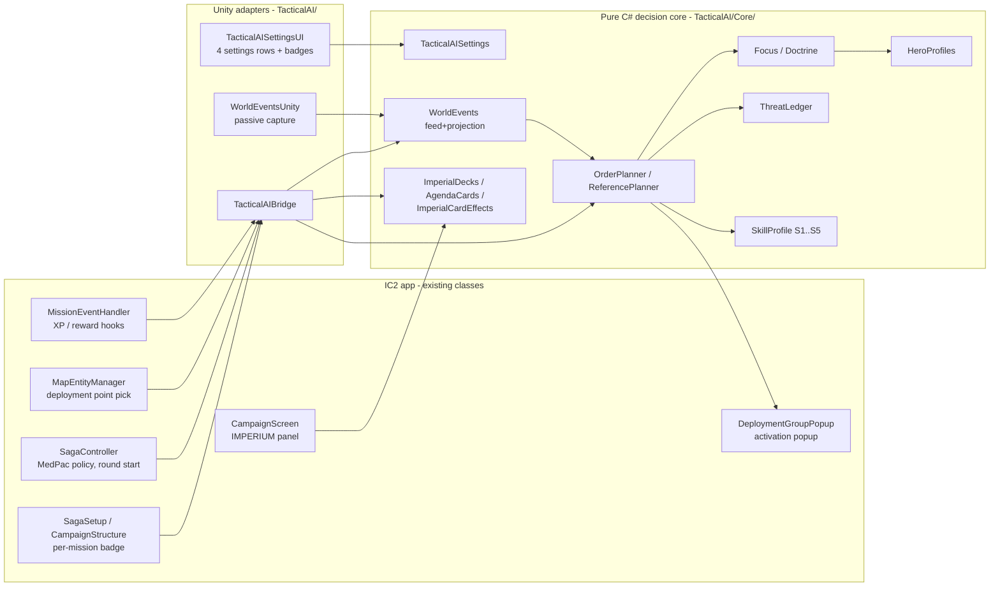
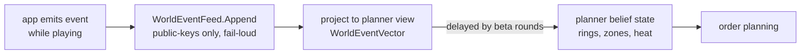
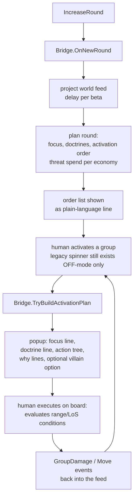
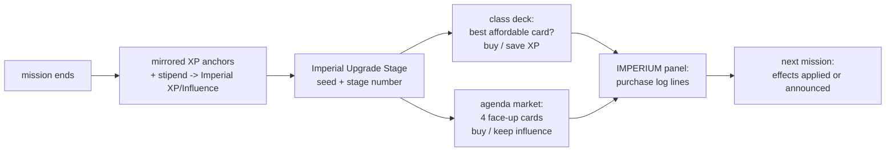

# Tactical AI — Mechanics Behind the Scenes

Mechanics reference for the Tactical AI mode, written in the style of the IC2 concept
docs. Every value in this document is read out of the shipped code and data files — file
and class names are given so anything can be checked. Diagrams are Mermaid (render
directly on GitHub).

- Code: `ImperialCommander2/Assets/Scripts/TacticalAI/` (pure-C# decision core in
  `Core/`, Unity adapters at the top level)
- Data: `ImperialCommander2/Assets/Resources/Languages/En/tactical_*.json`
- Tests/verification: `tools/TacticalAiHarness/` (parity harness), `Assets/Tests/` (NUnit)
- Player-facing doc: `docs/WIKI_tactical_ai.md`

---

## 1. Design principles (what the mode is allowed to be)

1. **Zero new input.** No feature may ever ask the human to report positions or states
   into the app. Everything the AI reads is either already in the app's mission data or
   already entered while playing. This is enforced in code, not just on paper (§5).
2. **Fair information.** The AI sees only public table knowledge. Hidden information
   (hero cards, dice, hands, villain deck) has no representation in the AI's vocabulary;
   the event feed **rejects unknown payload keys fail-loud** (`WorldEventFeed.Append`).
   The legacy hidden bonus-effect rolls never fire while a tactical mission is active.
3. **Human as actuator.** The app plans and orders; the board is the rules engine. Every
   order is an if–then tree whose conditions the human evaluates on the real board
   (range, line of sight). The app never decides "the hero stands on tile X".
4. **Determinism.** Same campaign seed + same mission + same difficulty ⇒ identical
   orders, purchases and market draws. The skill layer uses its OWN RNG stream derived
   from the mission seed; the legacy shuffle/dice RNG is never touched, so the
   "switch off" path stays bit-identical to the original app.
5. **Difficulty = decision quality, never power.** All five levels choose among the
   IDENTICAL set of legal options; a level changes only the selection (rank band,
   filters, delays, lookahead). Stats, ranges, action counts and option legality are
   never touched — verified by an option-set diff test that must always be empty.

## 2. Architecture

The core is Unity-free (it is compiled as a standalone project by
`tools/TacticalAI.Core/` for the parity harness), so the exact decision code that ships
in the app is the code the tests replay.

## 3. Where settings live

`TacticalAISettings` (serialized like other app settings, default **OFF**):

| Setting | Values | Consumed by |
|---|---|---|
| Master switch | OFF / ON | every hook; OFF means the legacy code path executes verbatim |
| Difficulty | S1..S5 named Recruit…Thrawn | `SkillProfile.For()` (§8) |
| Explain | NONE / AFTER THE FACT / FULL | popup "why" lines |
| Info text | ON / OFF | rules reminder block on popups |

Per mission, a campaign-mission badge cycles `AUTO → OFF → S1..S5 → AUTO`; `AUTO`
follows the global difficulty. Mission-level choice is stored on the mission item and
resolved at mission start (`TacticalAIBridge.TacticalMissionActive()`).

## 4. What the app actually knows (the world feed)

All of this is ALREADY digital in the app when playing a Saga mission; the mode reads it,
writes nothing back:

| Knowledge | Source in existing app data |
|---|---|
| Map geometry: tiles, walls, doors, room/region layout | mission `mapSections` / tile entities |
| Objective entity positions (terminals, crates, tokens, DPs) | entity list with `entityPosition` + type; ~1,660 deployment-point entities carry position + side |
| Round number, round limit (incl. runtime re-wires), objectives announced | `gameVars`, `OnChangeObjective` |
| Which deployment points were chosen, spawn groups | DeploymentManager state |
| Own group positions at spawn and own movement (the AI placed them) | the mode's own orders (spawn DP + activation outcomes) |
| Own group damage | the OPTIONAL per-group wound-tracker dial next to the deployment card (it is not tied to individual figures; if a table doesn't use the dial, the model only learns losses through Death/Removal events) |
| Hero wounded / defeated status | hero card toggles (`heroState.isWounded/isDefeated`) |
| Which hero activates when (public activation order) | activation events |
| Threat spend/replacement | `gameVars.threat`, threat ledger hooks |
| Campaign bookkeeping: hero items, known skills, XP | CampaignManager state (read-only) |

**What NOBODY in the app knows, by design:** figure positions on the physical board, line
of sight, hero hand/exhaustion state. These remain human calls at every difficulty.

### Event vocabulary (the complete surface)

`WorldEvents.cs` — append-only, per-mission, sequence-verified and hashable. Kinds:

`MissionStart, Spawn, Move, Death, Removal, ObjectiveChange, TileChange, FocusChange,
ThreatSpend, ActivationStart, ActivationEnd, HeroActivated, HeroWounded, HeroDefeated,
GroupDamage, RoundEnd, RoundLimitChanged`

Payloads carry only public values (names, zone labels, rounds, wheel damage numbers,
threat balance). Unknown keys are rejected.

Hero positions are modeled as **zones and rings, never points**: when a hero activates
the model widens a reachable ring around the last public location; a
`HeroWounded/HeroDefeated` flip during imperial activation says "a group could reach and
shoot that hero" and narrows the area. Difficulty controls how fresh this feed is (§8,
beta).

## 5. Focus selection (who gets shot at)

`Focus.cs` + `HeroProfiles.cs`. The round's focus target is computed once per round,
announced publicly at round start (and re-ranked each activation from the same keys):

1. **Wounded / defeated marks** outrank everything (except at S1/S2, which are
   `CounterBlind` and ignore them by design — that is the handicap, not a bug).
2. **Threat value per hero**, computed from the printed hero card values (dice pools,
   stamina, speed — digitized 1:1 for all 21 era-1 heroes into
   `tactical_hero_cards.json`) **plus the hero's own campaign purchases** (equipment
   tier×cost index, XP-cost ability index) — i.e. the hero who is really strongest on
   THIS campaign, not from a tier list.
3. Deterministic tie-break by table order.

The popup's "why" line states which key decided ("highest firepower among the remaining
heroes", "he is wounded — finish him first"). No hidden dice, no randomness except the
documented skill-layer fumble draw.

## 6. Doctrines (how a group plays the mission)

`Doctrine.cs` + `PatternWeights.cs` (M13u). Each group gets one of the named patterns
per round from **one single rule engine for every mission**:

1. **Printed movement law first** (no dice): a deployed Stativ/Tripod can only Guard —
   its printed rule forbids moving while set up; Massive groups never roll Hunter.
2. **Public weight row**: every group matches a row in
   `Resources/Languages/En/tactical_pattern_weights.json` (printed-flavour distribution,
   e.g. Stormtrooper 55 Advance / 10 Hunter / 25 Guard / 10 Block; bounty hunters
   60 Hunter; E-Web 100 Guard). First match wins; a catch-all row covers the roster.
   The file is reviewable in the repo — fairness rule: no hidden modifiers, ever.
3. **Mission-structure modifier as DATA, not code**: when the mission structurally
   defends (a Terminal entity or an escort priority target is in play), the authored
   defend row shifts it: Advance −25, Hunter −10, Guard +20, Block +15 (clamped at 0;
   a positive shift can open a pattern the row never carried). No second code branch —
   the mission clock's final third switches the row off (hunt phase), announced once.
4. **Per-round draw**: seed = mission session key ^ Fnv1a64(card id + round), so the
   doctrine is stable within a round, differs per mission, replays identically, and is
   disclosed in EXPLAIN=AUSFÜHRLICH as "Muster-Wurf: <doctrine> (draw N/100)" plus the
   full effective distribution on the Debug channel.
5. On top of the roll the two persona layers still apply unchanged: the captain's guard
   band pins the back half of the advancing squad in defend deployments (S4/S5), and
   persona pattern multipliers bias flips.

No asset / no matching row -> the legacy M4 classification branch runs bit-identical
(the pre-M13u fixtures stay green either way).

## 7. Round and activation pipeline

Key classes: `TacticalAIBridge.OnNewRound` (planner trigger), `TryPeekNextActivation`
(order preview for the UI), `TryBuildActivationPlan` (popup content),
`TryChooseDeploymentPoint` (reinforcement placement, §11).

Action economics on the popup follow the printed rules: at most two action slots, one
attack unless the card prints more (attack cap; IG-88-style multi-attack cards print
their own exception), doors cost an interaction action.

## 8. Difficulty = the SkillProfile table

`Core/SkillProfile.cs`. Each level is a parameter set; NOTHING else differs. The legal
option set is identical at every level (enforced by test).

| Param (meaning) | S1 Recruit | S2 Stormtrooper | S3 Veteran | S4 Commandant | S5 Thrawn |
|---|---|---|---|---|---|
| RankLo/Hi (focus rank band) | 2–4 | 1–2 | 1–2 | 1 | 1 |
| MissRate (fumble widens band) | — | 0.30→3 | 0.10→3 | 0.05→2 | — |
| CounterBlind (ignores wounded/killable) | **yes** | **yes** | no | no | no |
| Horizon (lookahead: 1 reactive / 2 race window 1 / 3 window 2) | 1 | 2 | 2 | 3 | 3 |
| FeedDelay (world feed staleness in rounds) | 2 (halved) | 2 | 1 | 0 | 0 |
| Positioning quality | first legal | hillclimb | shortest path, no lane-avoid | full planner | full planner |
| Economy (threat saving) | dump everything now | save 1 round | save 2, ±12% noise | save 2 | save 2 |
| Rho (risk judgement depth) | 0 always press | 1 only extreme | 2 thresholds | 2 thresholds | 3 full incl. threat replacement value |

Notes:
- All fumbles/draws come from a per-(seed, level) RNG stream — a higher level never
  gets luckier, only better.
- S1/S2 being `CounterBlind` is why "Veteran is the turning point": from S3 the wounded
  marks actually drive focus order.
- "Plans two rounds ahead" (S4/S5) is a **race computation against the heroes'
  reachable area** (movement envelope per ring), not a prediction of player decisions —
  it scores positions by how much they shrink the heroes' options.

## 9. Threat economy

`ThreatLedger.cs` + `RiskPosture.cs`. The Imperium's spendable threat is the mission
threat budget the app already tracks; the ledger models what is on the table (spawned
groups, their damage state) and what replacing a wounded group would cost. The economy
parameters (save rounds / force-after-idle / dump) decide when new groups may spawn;
risk posture (rho) decides between press / hold / disengage per group using own group
damage state (from the optional dial when the table uses it, plus death/removal events in
any case) and ring distance — with the fallback clauses printed on the popup.
`ThreatSpend` events flow back into the feed so the human sees the ledger reasoning in
the explain texts.

## 10. Villain special abilities and keyword rules

From S4 up, a third popup block can propose ONE special action per activation — only
from the `{A}` abilities **printed on the shipped villain card data** (17 printed
abilities: e.g. Darth Vader's Force Choke, General Sorin's Bombardment, Bossk's Wildfire;
Vader/Thrawn print none, so they get no block). Conditions shown are the card's own
printed conditions; the human judges whether they are met. Keyword mechanics that come
from unit keywords rather than cards (e.g. Stativ/Tripod "movement OR attack, never
both", attack caps) are enforced as printed text on the popup, never as hidden
modifiers. One example with a visible effect: a card that **prints Assault**
("multiple attack actions each activation" — the shipped roster prints it on
E-Web Engineer, E-Web Elite, AT-DP and IG-88) gets both action slots rendered as
attacks; every other figure keeps the printed one-attack-per-activation cap.
The keyword is read from the card's own printed ability line in every shipped
language, never from a hidden table.

## 11. Reinforcement deployment

`OptionalDeploy.cs` + `TryChooseDeploymentPoint`. Where a newly spawned group enters is
chosen deterministically from the plan among the mission's legal deployment points
(objective-proximity and focus-approach scoring) instead of a random DP pick. The
printed optional-deployment rule is honored for eligible cards. Deployment remains
public: the human could have made the same choice with the same information.

## 12. Campaign economies: Imperial class deck + agenda market

Both exist ONLY while the mode is on; legacy saves never gain the fields (additive
serialization, `state.imperialDeck == null` ⇒ no AI-owned economy present).

### Imperial class deck

- **Scope:** the 12 era-1 Imperial class decks, 109 cards, digitized 1:1 from the
  physical card templates (names, XP costs, printed effects) into
  `tactical_imperial_decks.json`; every card carries a classification row
  (`tactical_imperial_card_effects.json`).
- **Deck choice at campaign start:** deterministic scoring of the 12 decks against the
  campaign's villain family mix, hero count and agenda signals, plus seeded jitter;
  locked with the campaign. Only decks whose content box is in the player's activated
  collection compete (the decks' source boxes are digitization provenance — Core,
  Twin Shadows, Return to Hoth, Bespin Gambit, Jabba's Realm, Heart of the Empire,
  Tyrants of Lothal — 3 decks are Core-box and always eligible).
- **Income:** there is no hidden formula. The app's mission files book hero XP at ~279
  mission-end outcome anchors; the mode books Imperial XP **at exactly those same
  anchors** (mirrored hook) plus a fixed per-stage stipend. What the mission doesn't
  pay out to heroes, the Empire doesn't get.
- **Purchases:** run during the between-mission Imperial Upgrade Stage, deterministic
  greedy scorer over campaign state (seed salted), fully re-derivable; every purchase is
  a plain-language line in the IMPERIUM panel (campaign screen).
- **Effects:** the classification table maps each card to either an executable effect
  (activation efficiency, group attachments following the printed attachment lifecycle,
  stat lines from the card itself) or an announced-only effect (the panel prints it, the
  human plays it). No card can silently invent engine behavior.

### Agenda market

- **Scope:** 42 agenda sets, 126 cards (`tactical_agenda_cards.json`).
- **Market mechanics follow the printed rules:** six sets locked per campaign (seed),
  four cards drawn face-down per upgrade stage, Influence buys, unsold cards return
  unseen to their decks; "Kept Secret" is respected — secret text never appears on the
  rebel side of the UI before the card's own resolution requires it.
- Purchases: same deterministic scorer pattern; the IMPERIUM panel shows the ledger, and
  `AgendaPublicLedger()` / `AgendaImperialAuditView()` expose what is public vs. audit-
  only.

## 13. Integration hooks (the complete touch list)

Every place the app was touched, all guarded so OFF = legacy verbatim:

| Hook | App class | What it does when ON |
|---|---|---|
| Settings rows + badges | SettingsPanel (UI tab), campaign mission rows | master/difficulty/explain/info |
| Round start | `SagaController` IncreaseRound | planner round plan + feed advance |
| Activation popup | `EnemyActivationPopup` / `DeploymentGroupPopup` | plan-based popup, MedPac/bonus suppression |
| MedPac policy | `SagaController.OnMedPac/ApplyTacticalMedPacPolicy` | MedPac fully off (reference rules) |
| Reward text | `MissionEventHandler` + `ScrubMedpacRewardText` | crate MedPac rewards skipped & text scrubbed |
| Deployment point | `MapEntityManager` | deterministic reinforcement entry |
| XP hooks | `MissionEventHandler` CM6/CM7 | mirrored Imperial XP anchors, upgrade stage |
| Campaign load/save | `SagaCampaign` | additive Imperial deck/agenda state |
| Campaign UI | IMPERIUM panel | deck, purchases, agenda ledger |

## 14. Fairness invariants (each one has a test)

1. Master switch OFF ⇒ byte-identical legacy behavior (no hook executes).
2. Hidden bonus-effect rolls cannot fire in a tactical mission.
3. All difficulties share one legal option set (option-set diff must be empty).
4. Event feed has no vocabulary for hidden information; unknown keys rejected.
5. The skill RNG is a side stream; legacy shuffle/dice RNG untouched.
6. Agendas' secret text never renders before resolution requires it.
7. Imperial XP only at anchors where the mission pays hero XP.
8. Same seed + level ⇒ identical plan hash (`WorldEventFeed.HashOf`, log hash).

## 15. Verification (reproducible by anyone)

- **Parity harness** (`tools/TacticalAiHarness`, plain dotnet console): replays
  machine-generated golden vectors exported from a Python reference model the C# core was
  ported from; full run **36,974 checks / 0 fails**. Two ~250k-line vectors are not
  shipped in this PR (the harness SKIPs them; they regenerate on request).
- **NUnit**: 45 tests in `Assets/Tests/TacticalAI/Editor/` (fairness invariants above,
  settings/badge cycling, hook isolation, vector mirrors).
- Run locally: `dotnet run --project tools/TacticalAiHarness -- ImperialCommander2/Assets/Tests/Fixtures/tacai`

## 16. Known limits (honest list)

- No point-position world model and no LoS model — by design (§1); the human resolves
  sight lines at the board.
- One group per enemy card id (planner state keys on card id).
- Higher difficulties fall back to the reference brain on missions without the tactical
  world feed — logged loudly, never silent.
- Announcement-only card effects (see §12) require the human to apply them — deliberate,
  so no hidden engine behavior can appear.
